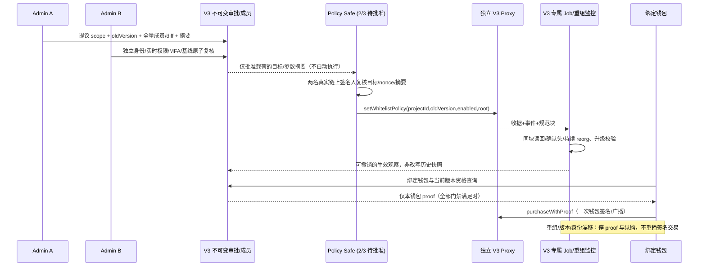

# IDO V3 白名单 M0 架构决策包（待签核，不是上线批准）

状态：**设计候选 / M0 未签核**。本文件把 [`IDO-V3-WHITELIST-DEVELOPMENT-PLAN.md`](./IDO-V3-WHITELIST-DEVELOPMENT-PLAN.md) 的 M0 决策、设计约束和验收证据集中供产品、安全、财务及运维审查。源码、测试和部署时的链上状态是事实依据；此文件不得作为部署、生产数据库写入、签名、上传、发放 proof 或解除 V3 门禁的授权。未取得下方具名批准与身份快照前，不得将“设计候选”改为“已冻结”。

## 1. 边界、基线与事实

- V3 仅用于**新建、尚未完成 Set、未上链**的项目；明确持久化 `funding_mode=capped_presale`、`contract_version=ido_v3_stablecoin`、chainId、独立 Proxy、projectId。既有 V2 Proxy、ABI、项目、资金、持仓和 Job 保持不变。旧 Setup／Set 草稿不自动转换；已绑定 V2 永不迁入 V3。跨版本不得用 `Purchased` topic 区分身份（签名相同）。
- 推荐初始策略在**创建项目后的 Pending 阶段**单独设定；不是 create 的暗含参数。激活需在链上读回与已批准策略一致后才走受控 V3 入口；公开项目应明确批准“保持关闭”而非把尚未设置误判为已经批准。`project_whitelists` Warmup 自登记不作为成员来源。
- 本地 `contracts/JoinCareIDOv3.sol` 是原型：owner 和 whitelistGovernor 均要求为合约；owner 掌管 UUPS 升级、暂停、手续费／资产配置、operator 更换及部分资金操作；`setWhitelistPolicy` 只允许 `whitelistGovernor` 调用；operator 不可修改策略。`whitelistGovernor` 目前**没有更换函数**；生产如需更换 Safe 地址，必须先有经审计的轮换设计，不能默认为 owner 已可直接轮换。`IDOv3TwoOfThreeGovernorMock` 仅是本地测试合约，不是 Safe。
- Backend 当前 `pkg/common/idov3whitelist` 的候选摘要、只读链观察和收据匹配不认证审批或数据来源。数据库基础迁移只允许 `unverified` runtime、`candidate` 快照及 `awaiting_governance` 执行；现有 Admin approval 拒绝 V3 操作，共享 outbox 拒绝 V3 action，Job shadow source 禁用，Web 只读。**不能因 M0 文档就解除这些门禁。**
- 离线开发基线可复现：合约 `feature/ido-v3-whitelist`（本文件编写时 `61241cb`）、Backend `feature/ido-v3-whitelist`（`8abdba4`）、Admin `feature/ido-v3-whitelist`（`4f712c6e`）、Deploy 独立 worktree `feature/ido-v3-whitelist`（以本地 Git HEAD 为准）、Web 本分支（`d6a4646`）。这些是开发参照，不是冻结的生产 artifact／审批签名／部署清单。V2 生产项目清单与现网 migration ledger 必须在独立**只读**生产预检中取得并另存签核摘要；合成 V2 行不是该清单。

## 2. 决策记录（拟定值；需要负责人确认）

| ID | 建议的 M0 选择 | 反例／待签核条件 |
| --- | --- | --- |
| D1 隔离 | 全新 UUPS V3 Proxy，绝不升级 V2，也不迁移 V2 项目或资金；V3 专属 ABI、配置、扫描、outbox action 和持久项目绑定。 | 现有 V2 项目清单及不可复用 Proxy 的生产只读核验未完成。 |
| D2 治理 | **选择两套专用 Safe（均建议 2-of-3）**：Policy Safe 仅作为 `whitelistGovernor`，Owner Safe 作为 `owner()` 并独占 UUPS 升级／暂停等 owner 权限；日常 operator/relayer 为第三身份，只做其明确允许的 V3 生命周期调用。Admin 两人审批≠两份 Safe 链上签名，两套 Safe 也不能默认是两组独立自然人。**不采用 EIP-712＋relayer 双签路线**；不得保留 owner/operator 的单签策略写入口。 | Safe 版本／部署工厂／Singleton／代理代码哈希、阈值、三名独立自然人及保管、重叠签名人上限、模块／guard／fallback／delegatecall／阈值变更权限尚需安全审查。Policy Safe 与 Owner Safe 的签名人尽量不重叠，提议上限 ≤1；是否可实现须签核。 |
| D3 首次策略 | Pending 经独立审批后执行策略更新；默认保持公开需有明确关闭模式审批与链上模式核对。Active 已开启才能继续更新成员；Active 首开／关闭均禁止。Pending 可经审批关闭；终态不可更新。 | 产品确认公开发行是否允许及 Pending 关闭后的激活规则；现有基础数据库仅支持 enabled 候选审计，关闭模式未实现。 |
| D4 成员 | 只判钱包地址，不附带个人额度／轮次／邀请码。Active 允许增／删整套成员快照，新版本仅影响其执行之后的购买；既有 claim/refund 不重新检查资格。提议完整名单 ≤4096，单次 diff ≤512（包括首次名单）；超限分批执行，每批重新审批、重新签名，不自动合并。 | 4096 来自当前离线/DB 上限；512 是**待产品与 gas 审查的拟定**操作上限，并非当前合约强制约束。无额外时间锁／冷却期的建议需风险接受；绝不承诺“立即”越过确认／重组门禁。 |
| D5 费用与最终性 | Safe 提议与执行 gas 由受控治理预算承担，公开申请号和执行回执；不得使用 V2 relayer 私钥手工发治理交易。建议 BSC 在至少 15 个包含交易块的确认后，再核对 canonical 收据块、确认头、Proxy 实现、项目、owner/governor、策略 root/version；每次对外资格发放还需持续重组/升级监控和版本复核。 | **15 不是最终性保证**；由安全／运维确认链特定深度、RPC 冗余与停服阈值、深重组恢复和 Safe gas 预算；没有批准值时 V3 保持关闭。 |
| D6 权限与轮换 | Owner Safe 不应同时成为 operator；两 Safe 权限分离；Safe 签名人变更须多签、独立通知与记录并暂停待审动作。Owner Safe 通过 Ownable2Step 所需的链上 acceptOwnership 后复核；禁止把政策 Safe 指向 EOA 或本地 Mock。 | V3 当前无 governor 地址轮换接口，需 M1 做经审计的轮换／冻结设计或明确“保留同一 Safe 地址，只轮换其 signer”；Safe 被攻陷／不能签名时的恢复与资金退出路径待签核。 |

任一提议不得自动视为已获用户、产品或安全批准；签核前如改变 D2/D3/D4/D5，更新本文件、对应合约/Backend/DB 测试和威胁模型，不沿用原回执。

## 3. 身份快照与审批载荷（不含密钥）

每个网络须生成一份人工审核并保存摘要的身份清单，含：chainId、环境、V3 Proxy／implementation 地址及代码哈希、`contractVersion()`、部署交易/块号/块哈希、startBlock、Owner Safe／Policy Safe 地址与实现/代理代码哈希、链上 owner/governor 读回、Safe singleton/工厂/版本/阈值、签名人公开地址与互异身份的线下保管证明编号、modules/guard/fallback 状态、operator 地址与 nonce fence、支付资产/项目资产允许列表、费率与收款方、金库/退款/退出责任人。部署**之前**地址未知则标 `UNSET`，不得从 V2 或默认配置填充。签名人私钥／助记词、数据库密码、JWT、签名、完整 calldata、原始 Provider／RPC 错误不得写入清单。

项目绑定需包含 `projectId` 原始十进制整数、chainId、Proxy、版本/模式、projectToken、paymentToken、projectOwner、募集区间、软／硬顶、费率及收款方快照；`onchain_locked` 后绝不改绑定。业务候选记录还须包含：动作 `enable|replace|disable`、oldVersion、newVersion、oldRoot、newRoot、canonical full member snapshot 与 digest/count、增删 diff、Pending/Active 状态及读回块哈希、发起/批准的独立 Admin ID、实时权限与 MFA 证据、过期时间及精确 Safe 目标／方法／参数摘要；一个 Admin 审批不得复用到另一个根／版本／项目。Safe tx nonce、提案引用、两名签署身份与最终链上 txHash、成功收据及版本/root 读回单独关联；候选摘要或“已执行”都不等于生效资格。

本地可复现的**非生产**快照来源：`JoinCare_SmartContract-main/test/fixtures/ido-v3-whitelist-v1.json`（1/2/3/5 成员），`test/fixtures/ido-v3-snapshot-v1.json`；Backend `pkg/common/idov3whitelist/testdata/` 对应 fixture；构造方式和精确编码见合约仓库 `docs/IDO-V3-WHITELIST-VECTOR-SPEC.md`。`schema=keccak256("JOINCARE_IDO_V3_WHITELIST_LEAF_V1")`，叶 = `keccak256(abi.encode(schema,chainId,proxy,projectId,buyer))`；按叶升序，排序配对哈希，奇数叶不重复，单成员 proof 为空，空 enabled 名单拒绝、重复钱包拒绝。快照摘要以完整排序叶、目标版本、作用域绑定；它不包含独立 Admin 身份或真实签名，所以单独不能授权 proof。

## 4. 状态转移与失败语义

链上策略：`Pending (off,root=0,v0)` → `Pending(on,root≠0,v1)` 或经审批维持公开；Pending 可 `on→off`，每次有实际变化则 `version+1`。`activateProject` 需校验模式/root 自洽；若选择有名单项目，还须已执行的 Pending 策略与批准快照最终核对。`Active(off)` **不能调用 setWhitelistPolicy 更新策略**（仍可走公开 purchase）；`Active(on)` 只能 `on→on` 更新整套名单与版本，不允许关闭。`Successful/Failed/Cancelled` 均不更新策略；claim/refund 按持仓/状态进行，不重查名单。旧版 proof 在新版上链后必须拒绝；审批旧版本、不同 Proxy、另一链、变更了身份或项目状态均 fail-closed。

| 项目状态／当前模式 | 提议模式 | 策略写入结果 | 资格与后续购买 |
| --- | --- | --- | --- |
| Pending/off | on，非零 root | Safe 治理且 oldVersion 精确，version+1 | 仅最终确认并关联批准完整成员后提供 proof；激活前不可购买 |
| Pending/on | on，变化的 root | 同上 | 更新只影响链上执行后的购买；旧 proof 失效 |
| Pending/on | off，零 root | 同上；关闭快照与审批流**未实现** | 激活后公开入口，旧 proof 不再使用 |
| Pending/off | off | 无变化，链上拒绝 | 公开模式需单独审批并核对，不能伪造一笔策略更新 |
| Active/on | on，变化的 root | 同上；允许增删成员 | 当前版本名单决定后续购买，已购仓位保留 |
| Active/on | off | 链上拒绝 | 保持原名单生效 |
| Active/off | on 或 off | 链上拒绝 | 只能公开入口；不得激活后首开 |
| Successful/Failed/Cancelled | 任意 | 链上拒绝 | 不影响历史持仓领取/退款 |

链下证据状态（**目标状态机，当前基础表和代码不具备这些迁移**）：`draft` → `candidate` → `pending_second_admin` → `approved_pending_execution` → `safe_proposed` → `safe_signed` → `submitted` → `confirmed_observed` → `effective`；拒绝/过期/冲突 → `rejected|expired|superseded`，失败收据 → `final_revert`，重组／升级／策略漂移 → `suspended_pending_reconcile`。两个 Admin 身份、权限/MFA/时效和不可变名单须在原子锁及提交事务内检查；批准后不能通过编辑成员或批准字段改变 payload。Safe 执行成功也需检查 target=精确 Proxy、策略事件、Receipt status、唯一日志、old/new version/root、规范块和深度、同块及确认头读回；不能把 Admin 审批状态 `executed` 直接映射 `effective`。重组后先停资格与相关写入、回退观察派生状态、复核旧证据及后继版本，**不重播已持久签名的 tx**；已回退交易必须正式对账为 `final_revert`，再由受控入口建新 attempt。历史不可变快照和审计保留，不修改旧版为新版。

```text
Admin A --(预览完整候选/diff/范围/过期)--> V3 candidate (无 proof)
Admin B --(实时权限+MFA+独立身份+基线原子复核)--> approved_pending_execution
批准载荷 --(仅 Policy Safe；2/3 独立签名)--> Safe 提案/执行 --> V3 Proxy.setWhitelistPolicy
链事件 + 收据 + 固定块 runtime/owner/governor/policy + 确认头 --(持续 reorg 监听)--> effective
钱包 --(绑定项目+当前版本+授权的完整快照)--> 仅本钱包 proof --> 钱包一次签名/广播
版本漂移/回退/升级/身份异常 --> suspended_pending_reconcile --> 禁止 proof 和新购买
```



`owner()` 升级、Safe 配置更改、pause/unpause、token 配置和 fee/receiver 变更走**独立 Owner Safe 管理动作与审核**；它们不是一次策略审批的附赠权限。owner 升级可绕过现有策略代码，因此安全声明必须包含 owner Safe 的真实阈值及代码/模块、升级时停服、差异审计和重新验收。

## 5. 威胁模型与剩余风险

| 风险 | 必要防线及未完成证据 |
| --- | --- |
| 旧 V2 入口／共享 Purchased topic 把 V3 当 V2 | 精确持久化 chainId+Proxy+projectId+version+token，独立 ABI、scan、ledger/outbox；旧路径负例与跨 Proxy 回归；M2 尚未 materialize。 |
| 报名污染／名单遗漏或审批后篡改 | 不读取 Warmup 资格；候选完整快照 canonical 排序/叶/digest、双人不同身份及实时权限/MFA、不可变批准记录和逐版本历史；M3 尚无真实批准态。 |
| operator/owner 单签或 Safe 配置绕过 | Policy Safe 唯一策略调用者；Owner Safe 独立约束 UUPS、模块/guard/签名人/阈值和升级；校验真实 Safe 而非仅有合约代码；签名人串通仍可越权，需保管隔离、独立审计与告警。 |
| 交易重播／夹块／链重组／RPC 不一致 | expectedVersion、Safe nonce、过期审批、交易前后 canonical 读回、确认深度、持续 reorg/upgrade 检测和暂停；确认高度不是最终性保证。当前只读证据不可标 effective。 |
| proof 缓存与未授权访问 | 钱包签名绑定 chainId/Proxy/projectId/地址/会话挑战，按当前 root/version 仅生成本钱包 proof，不返回全名单；未建 API，继续 fail-closed。 |
| 资产／受益人差错 | 创建时费率和 feeReceiver 快照、代币 decimals/allowlist、funds/claims/refunds 守恒、Safe gas 预算、链上资金实际接收方独立读回；资金/财务审查未签。 |
| Safe 失联、签名人轮换与 owner 升级 | 两 Safe 分开配置；签名人丢失无法保证恢复，须确定预案；owner Safe 能升级改变语义，升级必须重新审查和暂停；没有“单签紧急后门”。 |

## 6. M0 审查／测试矩阵与签核门禁

| 验证主题 | 最低验证与证据 | 状态 |
| --- | --- | --- |
| 身份隔离 | V2 生产项目/Proxy/资金只读清单、V3 新项目选路、chainId/Proxy/version/token 组合不可错配、部署编译/ABI/代码哈希可复现 | 仅合成 V2 行和本地 V3；生产只读清单**未核验** |
| Merkle 与快照 | JS/Go/Solidity 1/2/3/5 向量，odd/single/empty/duplicate，成员全量一致，跨链/项目/Proxy/钱包重放拒绝 | 本地向量已有；真实审批快照**未完成** |
| 治理与状态 | 两名独立 Safe 签名人授权/拒绝、Safe 模块/阈值及 Owner Safe 升级复核、Pending on/off、Active on→on、所有非法/终态、版本竞争 | Mock 本地测试已有；真实 Safe 方案和审查**未完成** |
| 执行与重组 | 改根、夹块、失败/重复回执、扫描/replay、长短 reorg、重启与逐笔财务对账、失效 proof 清除 | 只读函数/部分负例；M2/M3/M5 **未完成** |
| 财务／隐私 | 硬软顶、同块售出/退款/领取/提现、资产允许列表与收款方快照、gas 预算、无全名单/secret/RPC 原文泄露 | 本地部分单测；财务/安全审查**未完成** |

M0 **完成**要求以下均有具名负责人、日期、版本摘要和可复核签核记录（不要把签名本身或密钥贴到此仓库）：

1. 产品：D1/D3/D4 与公开项目策略、Active 增删、512 diff 上限、无额外时间锁及新建项目入口。
2. 安全/治理：D2/D5/D6；两 Safe 的真实实现、阈值、签名人保管、模块/guard/变更/轮换和 UUPS 权限；风险接受与威胁模型审阅。
3. 财务/运维：Safe gas 费用归属/预算、链特定确认深度与重组停服阈值、收款方核对与资金退出／恢复预案。
4. 工程：确定不可变 ABI/工件和项目身份快照（不含密钥），完成跨仓库测试矩阵、V2 生产只读项目清单与现网 schema/ledger 预检，解决与源码不符的设计差异。

当前全部上述签核项均**未收到**；M0 可交付审查包，但**不能标记为通过**，更不能据此执行 M1–M5 的生产步骤。默认保持 V3 approval、outbox、scanner、proof 与 Web 认购关闭。
